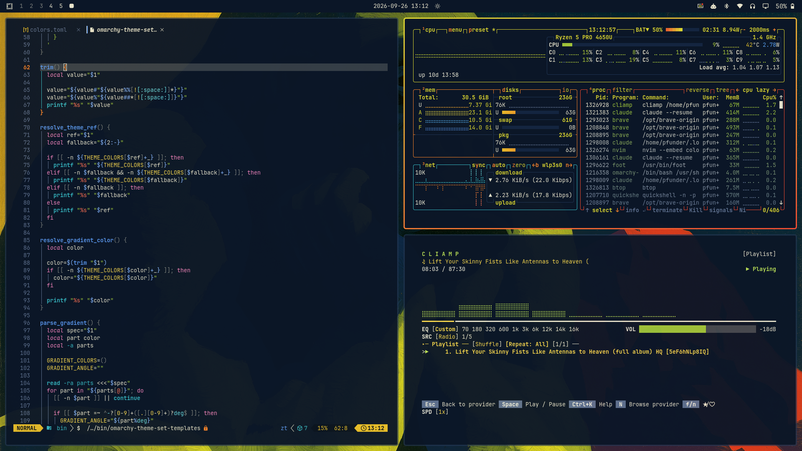

# Cyrk

A bold, dark [Omarchy](https://omarchy.org/) theme drawn from a series of
circus-poster paintings: chartreuse statues and animals lit against deep
night-navy skies and flat vermilion rock.



## Install

```bash
omarchy theme install https://github.com/<your-github-username>/omarchy-cyrk-theme.git
```

Or clone it manually into `~/.config/omarchy/themes/`:

```bash
git clone https://github.com/<your-github-username>/omarchy-cyrk-theme.git \
  ~/.config/omarchy/themes/cyrk
omarchy theme set cyrk
```

## Palette

| Role              | Hex       |                                                   |
| ----------------- | --------- | ------------------------------------------------- |
| Background        | `#0b1627` | deep navy, from the night skies                    |
| Foreground        | `#e7e3cc` | warm off-white                                     |
| Accent            | `#dcd630` | chartreuse, from the lit statues                   |
| Red               | `#f04a2e` | vermilion, from the rock flats                     |
| Orange            | `#f5812a` |                                                    |
| Yellow            | `#e8bd2a` | gold, from the gorilla's sky                       |
| Green             | `#9dc43a` |                                                    |
| Cyan              | `#36b7c2` |                                                    |
| Blue              | `#5a97ef` |                                                    |
| Magenta           | `#e25a9e` |                                                    |
| Selection         | `#3b3d1a` | olive, from the shadowed statue faces              |

The palette favors contrast over softness: every text color reads at least
4.9:1 against the background (WCAG AA), and there are no pastel-on-pastel
pairings.

## What's included

- `colors.toml` — the full palette. Everything Omarchy templates (terminals,
  Neovim, VS Code, Helix, Chromium, the shell, lock screen, keyboard RGB, and
  more) is generated from it, including a chartreuse-to-vermilion gradient
  window border via `hyprland_active_border`.
- `btop.theme` — hand-tuned graphs that climb from olive through chartreuse
  to vermilion.
- `backgrounds/` — five cyrk paintings (angel, elephant, gorilla, lion, polar
  bear) plus a plain night-navy wallpaper. Cycle with `omarchy theme bg next`.
- `unlock.png` / `preview-unlock.png` — the Omarchy logo in a
  chartreuse-to-vermilion gradient for the lock and boot screens.
- `icons.theme` — Yaru-yellow file manager icons.
- `preview.png` — desktop preview shown in the theme switcher.

Because the theme ships no Lua or terminal configs, it looks the same whether
it's installed from git or linked from a local working copy.

## License

[MIT](LICENSE). The artwork in `backgrounds/` is by Shawn Pfunder.
